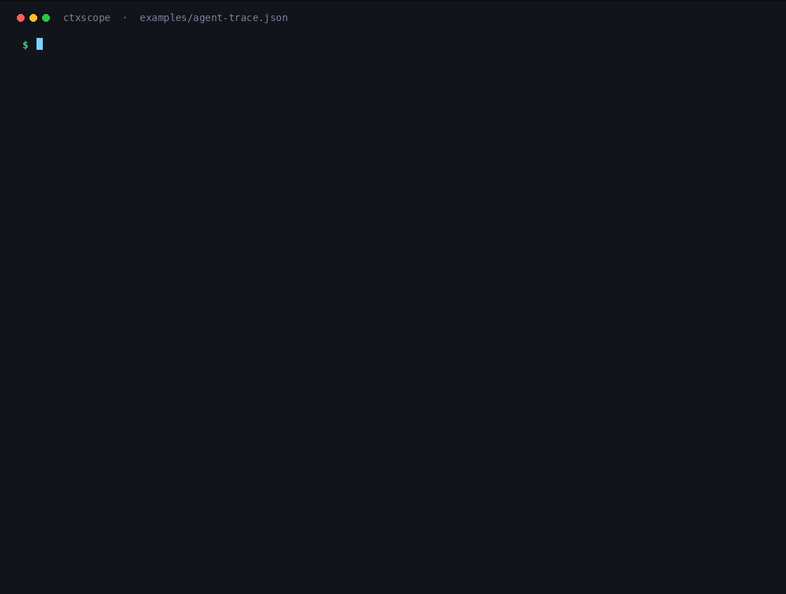
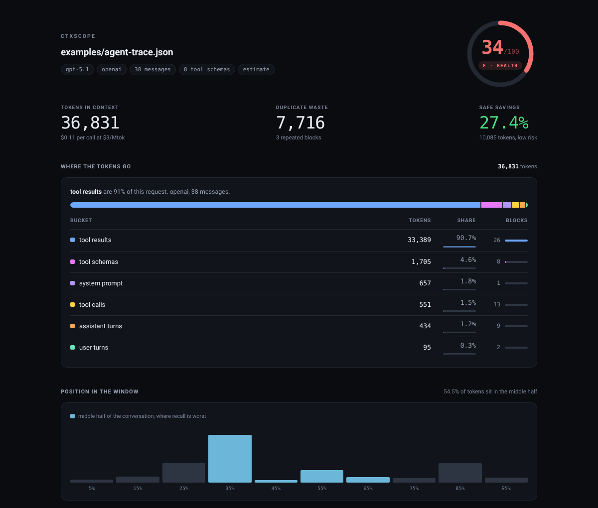
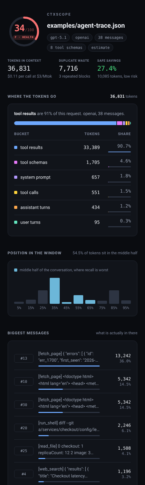

# ctxscope

**Your agent's context window is a black box. This opens it.**

Point it at one request from an agent run and it answers the only question that matters when the bill goes up and the answers get worse: *what is actually in there?*

It counts tokens by bucket, finds the blocks that are duplicated, finds the structure that costs tokens without buying information, and simulates what each trim would save. One file, standard library only, no account, no telemetry, no network calls.



## Run it

```bash
# no install, straight from the repo
uvx --from git+https://github.com/rawqubit/ctxscope ctxscope --demo

# or clone and run the single file
git clone https://github.com/rawqubit/ctxscope && cd ctxscope
python3 ctxscope.py examples/agent-trace.json

# exact token counts instead of the built-in estimator
pip install tiktoken
```

Point it at a request body, a trace, or a JSONL log. OpenAI, Anthropic, and raw message arrays are detected automatically.

```bash
ctxscope trace.json                      # terminal report
ctxscope trace.json --html report.html   # self-contained viewer, no CDN, works offline
ctxscope trace.json --json out.json      # the analysis, for CI
ctxscope trace.json --md out.md          # markdown, for a PR or an issue
cat trace.json | ctxscope -              # stdin
```

## What it prints

Real output for [`examples/agent-trace.json`](examples/agent-trace.json), a long agent run with the waste patterns that ship every day:

```
ctxscope 0.1.0  examples/agent-trace.json / gpt-5.1
openai / 38 messages / 8 tool schemas / tokens: estimate

  total           36,831 tokens   96,291 chars   $0.11/call at $3/Mtok
  context health  F 34/100   safe savings 27.4% (10,085 tokens)

WHERE THE TOKENS GO
  tool results      ██████████████████████    33,389   90.7%  26 blocks
  tool schemas      █·····················     1,705    4.6%  8 blocks
  system prompt     ······················       657    1.8%  1 block
  tool calls        ······················       551    1.5%  13 blocks
  assistant turns   ······················       434    1.2%  9 blocks
  user turns        ······················        95    0.3%  2 blocks

BIGGEST MESSAGES
  #13    tool      ██████████████    13,242  [fetch_page] { "errors": [ { "id": "err_1700", "first_seen": "2026-11-18T08:41
  #10    tool      ██████········     5,342  [fetch_page] <!doctype html> <html lang="en"> <head> <meta charset="utf-8"> <t
  #30    tool      ██████········     5,342  [fetch_page] <!doctype html> <html lang="en"> <head> <meta charset="utf-8"> <t
  #20    tool      ██············     2,246  [run_shell] diff --git a/services/checkout/config/ledger.go b/services/checkou
  #25    tool      ██············     1,508  [read_file] 0 checkout: 1 replicaCount: 12 2 image: 3 repository: registry.int
  #4     tool      █·············     1,196  [web_search] { "results": [ { "title": "Checkout latency regression #0: p99 21

DUPLICATES  7,716 wasted tokens
  x2    5,336 tokens each    5,336 wasted  <!doctype html> <html lang="en"> <head> <meta charset="utf-8"> <
  x3    1,190 tokens each    2,380 wasted  { "results": [ { "title": "Checkout latency regression #0: p99 2

STRUCTURAL WASTE
    2,218  Pretty-printed JSON in tool output
           6 blocks could be serialized compactly; indentation costs tokens on every turn
    1,422  Runs of whitespace and blank lines
           Stack traces and HTML dumps carry alignment padding the model does not need

TRIM SIMULATOR  (independent, against the full window)
  Drop duplicate blocks                                      7,716   20.9%  low
  Serialize JSON tool output compactly                       2,218    6.0%  low
  Squash whitespace and blank lines                          1,703    4.6%  low
  Truncate each tool result to 2000 tokens (head + tail)    18,180   49.4%  medium
  Keep only the last 3 tool results                         32,170   87.3%  high
  all three low-risk trims                                  10,085   27.4%
```

Note the shape of that: the run is 91% tool output, 21% of the window is repeated blocks, and every low-risk trim together is a quarter of the bill. That is the normal case, not a pathological one — and it is why a typical long agent run scores in the D to F band. That is the finding, not a calibration error: the failure mode the score measures is the one almost every team is already in.

## The five checks

| Check | Question it answers | How |
| --- | --- | --- |
| Composition | What is in the window? | Every part is classified as tool result, system prompt, tool schema, tool call, user, assistant, or image, then counted |
| Duplicates | What is in the window twice? | Blocks over 48 tokens are hashed after whitespace normalization; each repeat is counted and priced |
| Structural waste | What costs tokens and buys nothing? | Pretty-printed JSON, runs of whitespace, base64 blobs, constraints restated across messages |
| Trim simulator | What happens if I cut it? | Five trims are applied against the real text, each independently, plus all 32 combinations |
| Position | Where does it sit? | Token density across ten buckets of the conversation, and the share sitting in the middle half |

## The health score

One number, and every point is explained. Start at 100 and subtract:

| Penalty | Points | Cap |
| --- | --- | --- |
| Duplicated context | 2 per point of share above 2% | 30 |
| Tool output above 45% of the window | 0.6 per point | 15 |
| Verbose JSON serialization | 4 per point of share | 12 |
| A single message over 25% of the window | 0.6 per point | 12 |
| Tool schemas over 5% of every request | 1.5 per point | 8 |
| More than 30 messages in one request | 0.25 per message | 10 |
| Over 100,000 tokens in the working set | flat | 5 |

A: 85+, B: 70+, C: 55+, D: 35+, F: below 35. The score is a summary of the six checks, not a verdict on your prompt quality; `ctxscope` never sees the model's answer, so it cannot score that.

## The viewer

`--html` writes one file with no external requests: no CDN, no fonts, no analytics. Open it, or drop another trace on it, and the whole analysis runs in the browser.



- Composition bar and per-bucket table
- Position histogram, with the middle half highlighted
- Biggest messages with the exact preview
- Duplicate blocks, priced
- Trim simulator with live totals for all 32 combinations
- Mobile layout for reading a report on a phone



## Exact counts

The built-in estimator is calibrated against `cl100k_base` and lands within about 9% on prose, code, and mixed traces. It exists so the tool runs with zero install and zero network. If `tiktoken` is available, counts are exact:

```bash
pip install tiktoken
ctxscope trace.json --encoding o200k   # or cl100k
ctxscope trace.json --encoding estimate
```

Image blocks are counted at 1,105 tokens (one 1024×1024 high-detail tile). A JSONL log is analyzed on its last request, because that is the context the model actually saw on the final call.

## What it does not do

- It does not call your model or replay your run. It reads what you already sent.
- It does not judge whether your prompt is good. It judges whether the window is expensive.
- It does not know your price per token. The dollars line assumes $3 per million input tokens and is labeled as an assumption.
- It does not replace evals. Cutting 25% of a context is only good if the answers hold; that is what your eval suite is for.

## Why this exists

Every team that runs agents ends up with the same three surprises, in this order: the run is slow, the bill is high, and the quality is worst exactly where the context is thickest. All three come from the same place, and that place is invisible in every framework. You see a number from the provider after the fact, aggregated across a thousand calls, with no way to ask which message it came from.

`ctxscope` makes the window legible in one command, so the conversation moves from "the model got expensive" to "this tool result is duplicated six times and it is 12% of the call".

## Contributing

The repo is one file plus tests. A new check belongs in `find_waste()` or `compute_trims()`; a new input format belongs in `normalize()`. Run the suite before opening a PR:

```bash
make test
```

If you have a trace shape it does not recognize, open an issue with the first 200 characters of the JSON and the format name. Do not paste real keys or customer data.

## License

MIT.
